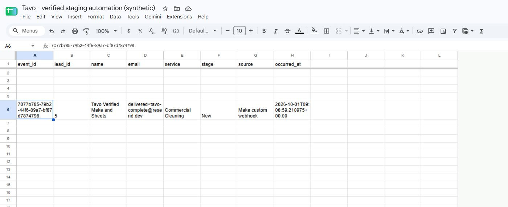

# Tavo live staging verification — 2026-10-01

**Both required Make scenarios are VERIFIED.** Real intake created a persisted CRM lead and actual AI analysis; the CRM event passed receiver signature checks and produced a real Google Sheets row. Replays retain one lead/analysis/event and one unchanged sheet row. Calendar was not executed and is optional; Zapier/n8n are compatible only.

Verified portfolio statement:

> I built a custom CRM with authenticated external APIs, secure event-driven webhooks, integration logging and retries, AI lead processing, and real Make.com workflows connecting CRM events with external business tools.

## Isolated staging deployment

- Branch `feature/automation-integrations`. Functional verification ran application commit `f767d774875b3e89eebeb4e663133716cbe5c5c7`; the final follow-up changes documentation/evidence only.
- [Staging API](https://cleanflow-api-staging.onrender.com/api/health): Render Free Docker, separate Neon PostgreSQL 18.6, migration revision `0004`, hosted Alembic check passes.
- [Staging frontend](https://tavo-web-staging.onrender.com): separate Render Free Node service, root `web`, Node 22.16.0, `npm ci && npm run build`, `npm run start -- --hostname 0.0.0.0 --port $PORT`.
- Staging override `python -m app.staging_server` migrates/bootstrap and supervises API/outbox worker. Production Docker command is unchanged. Free instances sleep; worker availability is not continuous.
- Staging has existing database/JWT/OpenRouter settings, `DEMO_MODE=false`, `EMAIL_TRANSPORT=log`, `EMAIL_LOG_PATH=/tmp/tavo-staging-outbox.jsonl`, empty demo recipient override, `INTEGRATION_ENCRYPTION_KEY`, integration limits 120/60 seconds, staging frontend/CRM origins and frontend `API_URL`. Credentials are private.
- Normal owner login, scoped API auth, invalid/revoked keys and CORS checks pass. Production feature code stays on master `609776a`; migration 0004 was not applied there.

## Scenario A — VERIFIED

Active Make scenario **Tavo A - Make intake to CRM and AI (staging)**, ID `6468861`: authenticated custom webhook → HTTP POST with scoped key/stable idempotency token → saved lead → actual AI classification → explicit response. Analysis was independently read through the external API and owner CRM.

- Synthetic source `tavo-live-b-e1c1447b-7d3d-49b9-b232-a245e6b17f67`, lead **5**, **Tavo Verified Make and Sheets**.
- Creation run `819b22d3e7544065aa5a1d3c77eb6b11`, `2026-10-01T09:08:56.580Z`: **Success**, 3 operations, 14.477 seconds, actual **HTTP 201**/lead 5.
- Actual model `deepseek/deepseek-v4.1-flash`; stored analysis `2026-10-01T09:09:06.088529Z`: Commercial Cleaning/**high**, persisted rationale and matched rules. CRM shows analysis/source/tags and successful automation history. Email was captured in the sandbox; no customer email was sent.
- Duplicate run `91095e28c37b4f71881a2fa18326f91f`, `2026-10-01T09:19:55.086Z`: **Success**, 3 operations, 1.798 seconds, **201**/original lead 5. Read-only database counts: exactly one lead, one analysis and one lead.created event.
- Historical lead 4 remains separately evidenced. Earlier mapping/scheduling attempts had errors/warnings, corrected before final verification. Both scenarios use `instant=true`, `sequential=false`; otherwise this account returned a queue acknowledgment before the final response. Strings use `escapeJSON`.
- A uses private legacy HTTP header configuration and confidential execution data. Its populated blueprint contains a key and is never published. Prefer managed HTTP credentials for client deployments.

[Combined live receipt](evidence/make-b-live.json) · [Actual classified CRM lead](evidence/make-complete-crm.png) · [Earlier A receipt](evidence/make-a-live.json)

## Scenario B — VERIFIED

Active Make scenario **Tavo B - CRM events to Google Sheets (staging)**, ID `6468884`. Tavo destination **Make Google Sheets - staging workflow** subscribes to `lead.created`.

Persisted event → signing worker → raw Make webhook → HMAC/timestamp/schema checks → event dedupe → managed Google Sheets API call → completion record → explicit 200 response.

- Google connection tests successfully with **Sheets-only** OAuth; Drive was not granted. Make created the synthetic spreadsheet and performed the actual row operation through its managed connection. No direct Google-token script substituted for Make.
- Event **`7077b785-79b2-44f6-89a7-bf87d7874798`**, `lead.created`, `2026-10-01T09:08:59.210975+00:00`.
- Persisted Tavo delivery **1**, attempt **1**, **succeeded / HTTP 200**, started `2026-10-01T09:09:02.147973+00:00`, finished `2026-10-01T09:09:04.848468+00:00`. Delivery records were not edited to manufacture success.
- Make run **`6583906d0a50454c9a388028cf8de1b2`**, `2026-10-01T09:09:04.112Z`: **Success**, 9 operations, 552 ms. Actual webhook operation output was read from Make. Raw input matches Tavo's signed bytes exactly; SHA-256 `6e23ebae2a3f3fdae9811cd63e427dd0579ff7878161fe3f523eab54db37c325`.
- Actual Sheet **Tavo - verified staging automation (synthetic)**, ID `1m0B7neolZ-4UmkPQNYLTMvz9ZJKNOUbydNU7R5aGo7E`, **`Leads!A6:H6`**. Independently exported Google CSV contains exactly one matching row; all eight event/lead/business/time fields match. The Sheet stays private to its owner; evidence is synthetic.
- Signed duplicate run **`cd1f40be8c0c4527b205aa94aa087774`**, `2026-10-01T09:19:54.252Z`: **Success**, 7 operations, 264 ms, actual **200 / duplicate**, original IDs. Sheets was skipped; the second independent CSV export equals the first, with one matching row.
- First replay exposed a mapping error: Make's machine field is `exist`, while the UI says “Exists.” Corrected before final replay. The earlier replay safely PUT the same fixed row; it did not append. Final replay correctly uses the completion-store skip route.
- Live probes rejected bad/missing signatures, stale timestamps and tampered bytes with **401**, invalid identity/unsupported events with **422**, authenticated malformed JSON with **400**, before any Sheets action. [Actual responses](evidence/make-b-security-checks.json).
- Confidential execution data was temporarily disabled for synthetic proof, then restored. Both required scenarios remain active; the setup utility is inactive. A temporarily exposed receiver was replaced/revoked before the real run; current path/signing secret remain private.

[Live receipt](evidence/make-b-live.json) · [Received event](evidence/make-b-received-event.json) · [Before replay CSV](evidence/make-b-sheet-before-replay.csv) · [After replay CSV](evidence/make-b-sheet-after-replay.csv) · [Successful Make history](evidence/make-b-runs.png)

## Resend rotation — VERIFIED

Old **Onboarding** and the discarded exposed replacement are revoked. Final **Tavo sending key — 2026-10-01 replacement** has sending-only access, is persisted in production Render, and restarted the existing master baseline. Production health returns 200; feature code was not deployed there.

The final key returned HTTP 200 for Resend's safe delivered test sink, email ID `01a0f621-c51c-723c-8c03-c2a218748d40`, `2026-10-01T06:23:23.253366Z`. This proves provider acceptance, not human inbox delivery. A discarded replacement appeared in a tool readout and was revoked before using the final unexposed key. No credential is included in Git or published evidence. [Sanitized receipt](evidence/resend-rotation.json).

## Checks and practical limits

- Offline suite: **99 passed, 1 optional PostgreSQL case skipped**, including all previous cases. Isolated PostgreSQL 17.11 suite: **100 passed**, fresh/populated migration/backfill, downgrade/upgrade and drift checks. Hosted staging 18.6 revision 0004 passes Alembic check. Frontend typecheck/build pass.
- Timeout/non-2xx/backoff/manual retry, claims, removal/revocation, demo isolation and authorization are verified offline. Real Make validation, successful delivery/Sheets action and duplicate handling are verified live. Google/store error routes return 503, but a real Google outage/manual retry was not deliberately induced.
- Sheets uses row `lead_id+1` plus completion dedupe: IDs 1–999, blank unused rows, lead.created snapshots only. Do not sort/delete reserved rows. Expand capacity and define ordering/update policy before additional subscriptions. Parallel copies may PUT the same row; no universal exactly-once guarantee is claimed.
- Render Free sleeps; email logs are ephemeral; persistent outbox resumes when the worker runs. Rate limits are process-local. Keys have no automatic expiry; logs/requests need retention management. Existing single-business ownership and synchronous AI processing remain.
- Keep populated scenario configuration private. The reusable blueprint replaces resource/secret bindings; importing it does not establish verification. Review managed HTTP credentials/access/retention before client use.
- Zapier/n8n are compatible only; no executed workflow/professional experience claim. Calendar was not executed and is not required.

Reproduction and sanitized blueprint: [MAKE_WORKFLOWS.md](MAKE_WORKFLOWS.md). Architecture/endpoints/signing: [INTEGRATIONS.md](INTEGRATIONS.md).
